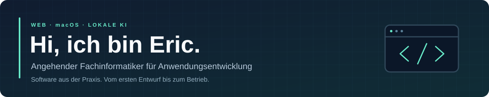
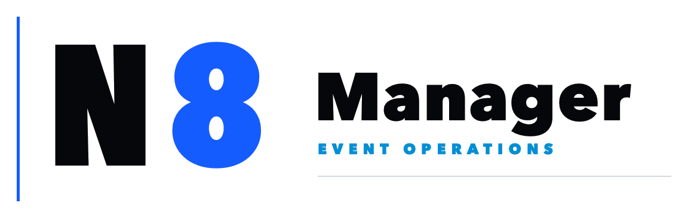
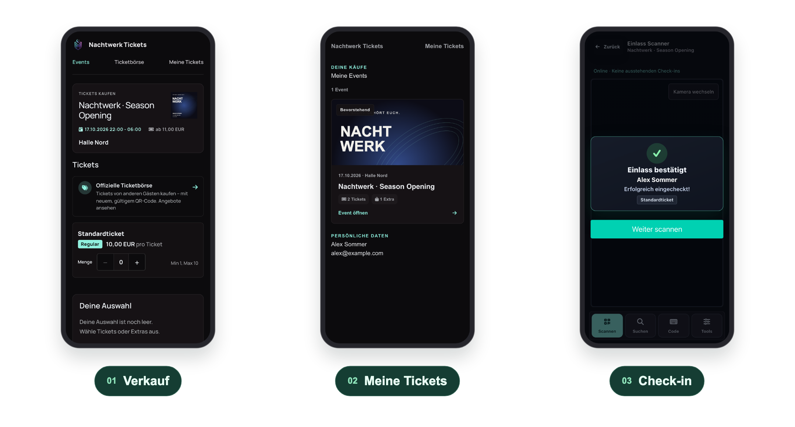
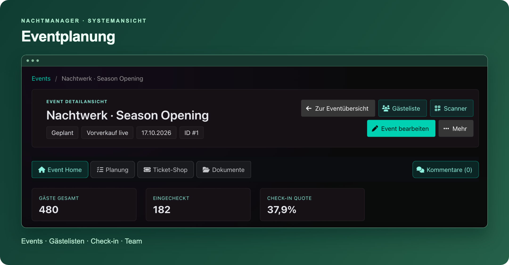
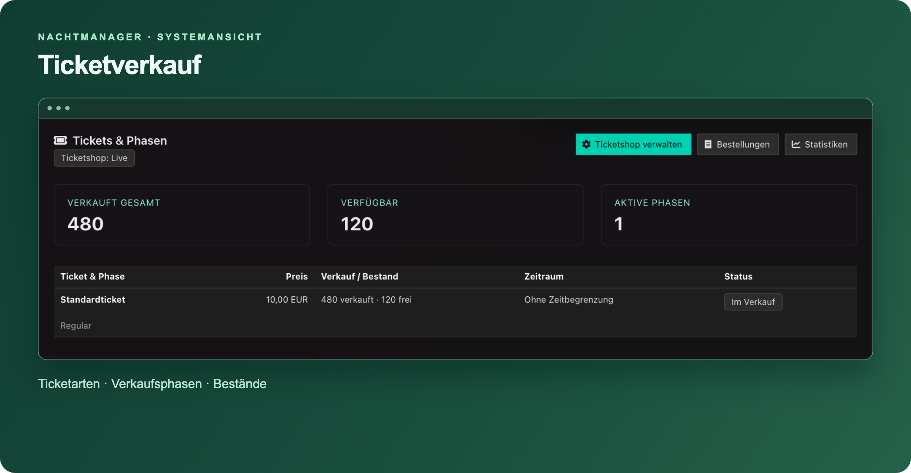
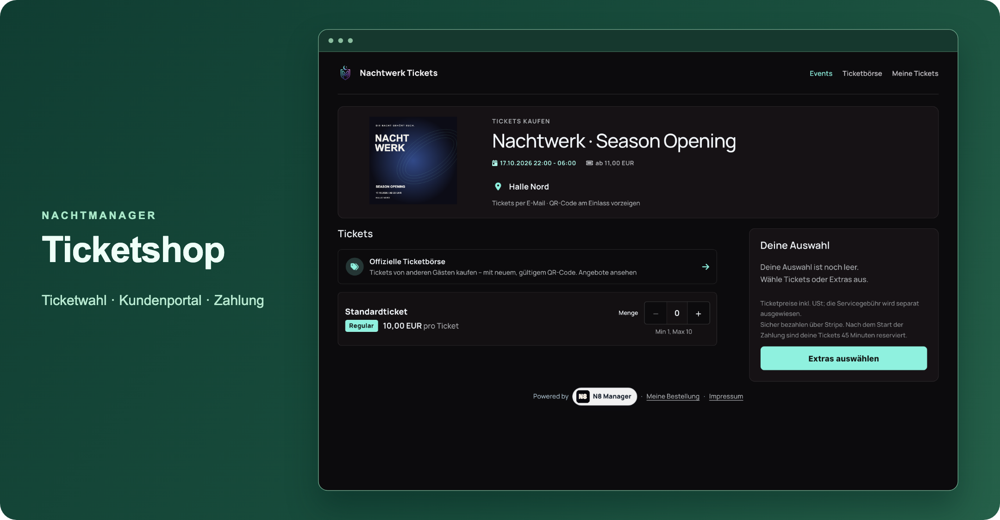
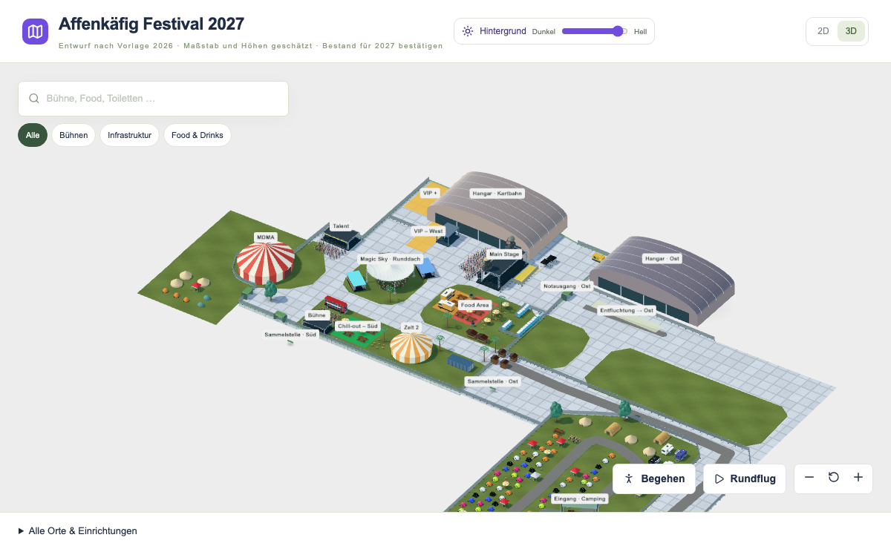
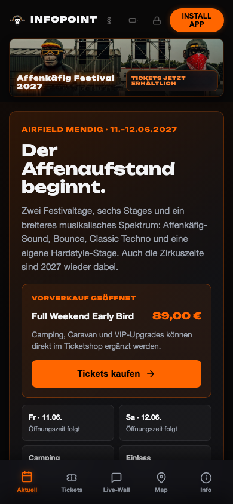

Ich entwickle **Webanwendungen, macOS-Tools und lokale KI-Anwendungen** – mit einem Schwerpunkt auf Eventbetrieb, Automatisierung und verständlichen Oberflächen.

  
  
  
  
   
  
  
  
  
  

## Mein größtes Projekt

<a href="https://n8manager.de/">
  <picture>
    <source media="(prefers-color-scheme: dark)" srcset="assets/logos/nightmanager-dark.png">
    
  </picture>
</a>

**Eventplanung, Ticketverkauf und Einlass in einer Plattform.** Gästelisten, QR-Check-in, Stripe-/WooCommerce-Anbindung, Teamchat, Aufgaben und Newsletter – ergänzt um Rollenrechte, Monitoring und Backups.

**Vom Ticketkauf bis zum Einlass.**

**Einblicke ins System** · Bilder zum Vergrößern anklicken

<table>
<tr>
<td width="50%" valign="top" align="center">

<strong>Ticketverkauf</strong>
</td>
<td width="50%" valign="top" align="center">

<strong>Ticketshop</strong>
</td>
</tr>
</table>

**PHP · MySQL/MariaDB · JavaScript · Stripe-Webhooks** 
[Produktwebsite ↗](https://n8manager.de/) · Aktive Weiterentwicklung · Quellcode privat

## Festivalplaner

**Backstage Festival Studio** – Festivalgelände in 2D und 3D planen: Bühnen platzieren, Wege zeichnen, Kartendaten importieren und Besucherkarten veröffentlichen.

**TypeScript · React · Three.js · Leaflet** 
[Öffentliche Besucherkarte ansehen ↗](https://planer.backstageapps.de/map/71bafce6-3b05-456c-a2d7-a9265b017401)

## Weitere Projekte

<table>
<tr>
<td width="50%" valign="top">

<h3>Stimmwerk</h3>

Lokale Spracheingabe für macOS. Diktieren, Audiodateien transkribieren und Text direkt in andere Apps einfügen.

<strong>Python · Parakeet/ONNX · SQLite</strong>

</td>
<td width="50%" valign="top">

<h3>Haushaltsbuch</h3>

Einnahmen, Ausgaben und Budgets im Blick. Mit Bank-CSV-/PDF-Import, Beleg-OCR und Duplikaterkennung.

<strong>React · TypeScript · Node.js · SQLite</strong>

</td>
</tr>
<tr>
<td width="50%" valign="top">

<h3>SysInfoTool</h3>

Native macOS-Menüleisten-App für CPU, RAM, Netzwerk, Akku und weitere Systemmetriken.

<strong>Swift · AppKit · IOKit</strong>

</td>
<td width="50%" valign="top">

<h3>Webtropolis AI</h3>

Eigener KI-Chat mit Web- und Mac-App, lokalen Modellen auf Desktop und Raspberry Pi sowie Sprachfunktionen.

<strong>JavaScript · Tauri/Rust · Linux</strong>

</td>
</tr>
</table>

## InfoPoint · Die Festival-App fürs Smartphone

<table>
<tr>
<td width="30%" align="center">

</td>
<td width="70%" valign="middle">
<h3>Affenkäfig InfoPoint</h3>

Festivalinfos, Geländeübersicht, Live-Wall und Push-Mitteilungen in einer installierbaren PWA.

<strong>JavaScript · PHP · SQLite · Web Push</strong>

<a href="https://infopoint.affenkaefig-festival.de/">App öffnen ↗</a>

</td>
</tr>
</table>

**Auch öffentlich zum Ausprobieren:** [Amazon FBA / FBM Rechner](https://webtropolis-de.github.io/amazon-fba-fbm-rechner/) – Marge, Gebühren und Deckungsbeitrag. [Quellcode ↗](https://github.com/webtropolis-de/amazon-fba-fbm-rechner)

---

Klare Oberflächen, wartbarer Code und nachvollziehbare Daten. Ein Teil meiner Projekte ist privat; die Bilder zeigen öffentliche Ansichten oder ausdrücklich fiktive Beispieldaten.

**[Website](https://webtropolis.de/) · [GitHub](https://github.com/webtropolis-de)**
