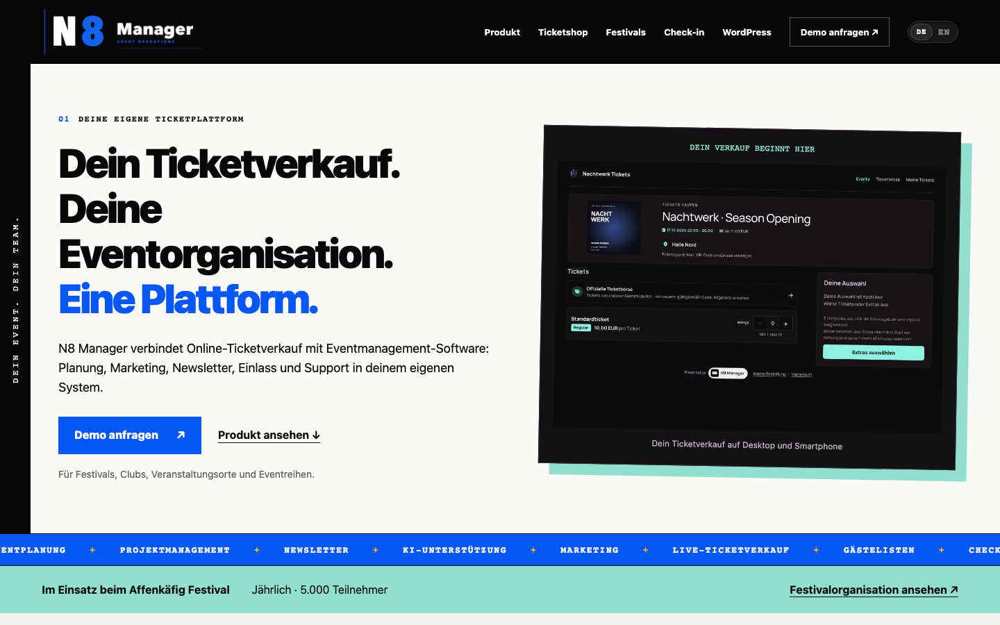

# Hi, ich bin Eric

Ich bin angehender Fachinformatiker für Anwendungsentwicklung und entwickle Software für Aufgaben, die mir in der Praxis begegnen: Veranstaltungen organisieren, Sprache in Text umwandeln, Finanzen auswerten und Arbeitsabläufe automatisieren.

Mein größtes Projekt ist **Nachtmanager**. Daneben entstehen Webanwendungen, macOS-Tools und eine eigene Chat-Anwendung mit lokalen KI-Modellen. Mich interessiert der ganze Weg: vom konkreten Bedarf über Oberfläche, Datenmodell und Schnittstellen bis zu Tests und Betrieb.

## Nachtmanager · Eventmanagement von der Planung bis zum Einlass

Eine webbasierte Plattform für Eventteams, Clubs und Veranstalter. Aus den Anforderungen des Veranstaltungsbetriebs entsteht eine Anwendung, die Planung, Ticketverkauf, Einlass und Teamarbeit zusammenführt.

**[Zur Produktwebsite → n8manager.de](https://n8manager.de/)**

- **Planung:** Veranstaltungen, Locations, Artists, Crew und Timetables verwalten; veröffentlichte Geländepläne einbinden.
- **Gäste und Einlass:** Gästelisten, Registrierungslinks, QR-Tickets sowie eventbezogener Check-in und Check-out mit Hinweisen bei Doppelscans.
- **Ticketverkauf:** eigener Ticketshop mit Ticketarten und Verkaufsphasen, Stripe-Checkout, Webhook-Verarbeitung, Ticket- und Rechnungsversand sowie WooCommerce-Anbindung.
- **Team und Kommunikation:** Direkt- und Gruppenchats, Aufgaben mit Zuständigkeiten, Support-Tickets und Newsletter-Kampagnen.
- **Administration:** Rollen- und Modulrechte, Monitoring, Backups und Wartungsfunktionen.

**Technik:** PHP · MySQL/MariaDB · JavaScript · HTML/CSS · Bulma · REST APIs · Stripe-Webhooks

**Technischer Schwerpunkt:** zusammenhängende Geschäftsprozesse, Berechtigungen, externe Schnittstellen und die Weiterentwicklung einer Anwendung im laufenden Betrieb. Änderungen prüfe ich mit passenden Syntax-, Audit- und Smoke-Checks; Bereitstellungen erfolgen mit Vorher-Backup und Prüfung auf Dev vor Live.

*Aktive Weiterentwicklung · Quellcode privat*

Einblick: öffentliche Produktwebsite mit Ticketshop-Vorschau

## Weitere ausgewählte Projekte

### Stimmwerk · Lokale Spracheingabe für macOS

Eine Menüleisten-App für Apple-Silicon-Macs: Sprache lokal transkribieren und den erkannten Text direkt in das aktive Textfeld einer anderen Anwendung einsetzen.

- Push-to-Talk und Toggle-to-Talk mit globalen Tastenkürzeln.
- Audiodateien transkribieren, Diktatregeln anwenden und einen lokalen Verlauf nutzen.
- Lokale Spracherkennung mit NVIDIA Parakeet TDT v3 über ONNX Runtime; optionale KI-Textüberarbeitung in der Vollversion separat zuschaltbar.
- Mit **Stimmwerk Lite** entsteht eine fokussierte Variante für den Diktierablauf.

**Technik:** Python · ONNX Runtime · SQLite · macOS-Integration

**Schwerpunkt:** lokale Modellinferenz, Audioverarbeitung und appübergreifende Texteingabe.

### Festivalplaner / feldstudio · Geländeplanung in 2D und 3D

Ein browserbasierter Editor, um Festivalgelände maßhaltig zu planen und daraus öffentliche Besucherkarten zu veröffentlichen.

- Bühnen und weitere Objekte platzieren; Wege, Zäune und Geländegrenzen zeichnen.
- Zwischen 2D- und 3D-Ansicht auf einem gemeinsamen Planmodell wechseln.
- OpenStreetMap-Daten als Umgebungsvorlage importieren und Hintergrundbilder kalibrieren.
- Pläne unter anderem als PDF, PNG, SVG, CSV und JSON exportieren.
- Öffentliche Karten als gefilterte Momentaufnahme veröffentlichen, getrennt von internen Planungsdaten.

**Technik:** TypeScript · React · Three.js · Leaflet · Cloudflare Workers/D1/R2

**Schwerpunkt:** interaktive Editoren, Geometrie, Datenexport und die Trennung privater Projekte von öffentlichen Ansichten.

### Haushaltsbuch · Finanzübersicht mit Import und Budgetplanung

Eine Webanwendung für Einnahmen, Ausgaben, wiederkehrende Buchungen und Kategorie-Budgets.

- Bank-CSV-Dateien und PDF-Kontoauszüge importieren; OCR für Belege und Screenshots.
- Erkannte Buchungen vor der Übernahme prüfen und Duplikate erkennen.
- Buchungen über eigene Regeln kategorisieren und Budgets grafisch auswerten.
- Finanzdaten in SQLite speichern sowie Sicherungen und Exporte erstellen.

**Technik:** TypeScript · React · Node.js/Express · SQLite · Recharts · Tesseract.js

**Schwerpunkt:** uneinheitliche Eingabedaten aufbereiten und nachvollziehbare Auswertungen erstellen.

### Affenkäfig InfoPoint · Festivalinformationen als PWA

Eine für Smartphones ausgelegte Festival-App im Browser mit Informationen, Geländeübersicht und Community-Funktionen.

- Installierbare PWA mit Service Worker.
- Festivalinformationen, Kartenansicht sowie Notfall- und Awareness-Hinweise.
- Live-Wall mit Beiträgen und Kommentaren sowie administrative Moderation.
- Push-Mitteilungen für Festival-Updates; Timetable und Favoriten-Erinnerungen abhängig vom veröffentlichten Programm.

**[InfoPoint öffnen](https://infopoint.affenkaefig-festival.de/)**

**Technik:** JavaScript · HTML/CSS · PHP · SQLite · Service Worker · Web Push

**Schwerpunkt:** mobile Bedienung, Community-Funktionen und saisonal wechselnde Veranstaltungsinhalte.

Screenshot: mobile InfoPoint-App

### SysInfoTool · Systemmetriken in der macOS-Menüleiste

Eine native macOS-App, die Systemzustände kompakt in der Menüleiste und einem Popover darstellt.

- CPU, Arbeitsspeicher, Netzwerk-Traffic, Datenträgeraktivität und Prozesse mit hoher CPU-Last.
- Akkuinformationen, kompakte Verläufe und farbige Statusindikatoren.
- Temperatur und Lüfterdaten, soweit die Hardware diese bereitstellt.
- Einstellbare Detailgruppen, Icon-only-Modus und Autostart.

**Technik:** Swift · AppKit · IOKit · ServiceManagement

**Schwerpunkt:** native macOS-Entwicklung, Systemmetriken und eine platzsparende Oberfläche.

### Webtropolis AI · Eigene Chat-Anwendung mit lokalen Modellen

Ein laufendes Entwicklungsprojekt mit Weboberfläche und Mac-App. Lokale Modelle auf Desktop und Raspberry Pi werden über eine gemeinsame Chat-Oberfläche angesprochen; der Pi kann Textanfragen übernehmen, wenn der Desktop nicht verfügbar ist.

- Projektchats, Quellenansicht und Mediengalerie.
- Diktieren, Sprachgespräche und Automationen.
- Lokale Projektordner und geprüfte Dateiänderungen in der Mac-App.
- Arbeit an Modellwahl, Geräteübergabe, Antwortzeiten und nachvollziehbaren Release-Abläufen.

**Technik:** JavaScript · Tauri/Rust · lokale Modellanbindung · Raspberry Pi · Linux

**Schwerpunkt:** Modellintegration, Client-Server-Kommunikation und Betrieb auf begrenzter Hardware.

### Amazon FBA / FBM Rechner · Öffentlich ausprobieren

Ein Browser-Tool zur Kalkulation von Amazon-Angeboten: Marge, Deckungsbeitrag und Gebührenaufschlüsselung, ergänzt um PDF-/CSV-/Excel-Export und lokale Speicherung im Browser.

**[Live-Demo](https://webtropolis-de.github.io/amazon-fba-fbm-rechner/) · [Quellcode](https://github.com/webtropolis-de/amazon-fba-fbm-rechner)**

**Technik:** HTML · CSS · Vanilla JavaScript · GitHub Pages

## Womit ich arbeite

| Bereich | Technologien und Themen |
| --- | --- |
| Web und Backend | PHP, Python, JavaScript, TypeScript, Node.js/Express, React |
| Daten und Schnittstellen | MySQL/MariaDB, SQLite, REST APIs, Webhooks, CSV/PDF-Import |
| Desktop und lokale KI | Swift/AppKit, Tauri/Rust, macOS-Integration, ONNX Runtime, Raspberry Pi |
| Darstellung | HTML/CSS, Bulma, Three.js, Leaflet |
| Arbeitsweise | Git, Dokumentation, automatisierte Prüfungen, Backups, Dev-/Live-Bereitstellung |

## Was mir wichtig ist

Ich möchte Software entwickeln, die im Alltag hilft: mit klaren Oberflächen, nachvollziehbaren Daten und wartbarem Code. Dazu gehören für mich auch Fehlerfälle, Berechtigungen, Dokumentation und ein kontrollierter Betrieb.

Ein Teil meiner Projekte ist privat. Dieses Profil zeigt deshalb neben öffentlichem Quellcode auch die Aufgaben und technischen Schwerpunkte meiner weiteren Anwendungen.

## Kontakt

**[webtropolis.de](https://webtropolis.de/) · [GitHub](https://github.com/webtropolis-de)**
